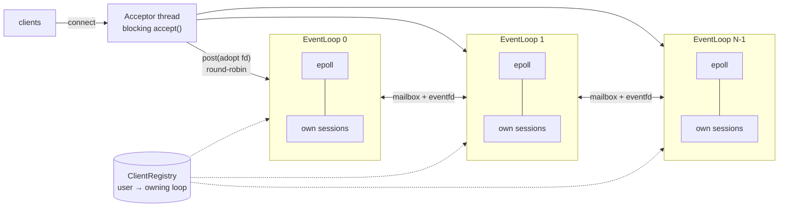

# chat_server

A multi-user TCP chat server in C++17 on Linux, built as a **multi-reactor**: one `epoll` event loop per thread, with threads exchanging work through eventfd-signalled mailboxes instead of sharing client state.

It started as a thread-per-client server and was rebuilt in measured steps. At **10,000 concurrent connections** on the same machine:

| | thread-per-client | multi-reactor (8 loops) |
|---|---:|---:|
| Throughput | 467k msgs/s | **701k msgs/s** (1.5x) |
| Server memory (RSS) | 136 MB | **9.1 MB** (15x less) |
| Threads | 10,001 | **9** |
| Time to log in 10k users | 13.7 s | **0.18 s** |
| Median latency | 9.1 ms | **6.7 ms** |

Race-free under ThreadSanitizer. Full numbers and method are under [Benchmarks](#benchmarks).

## Features

Clients connect over plain TCP (e.g. `nc localhost 5599`), log in with a username and password, then send one command per line:

| Command | Effect |
|---|---|
| `/msg <user> <text>` | Private message |
| `/broadcast <text>` | Message to everyone online |
| `/create_group <name>` · `/join_group <name>` · `/leave_group <name>` | Group membership |
| `/group_msg <name> <text>` | Message to a group you belong to |
| `/online` | Who is online (count and first 100 names) |
| `/exit` | Disconnect |

## Architecture



**Ownership rule.** Each connection belongs to exactly one `EventLoop` for its whole life, and only that loop's thread ever touches its session (socket, input/output buffers, login state). Sessions therefore need no locks.

**Cross-thread delivery.** When alice (loop 0) sends `/msg bob hi` and bob lives on loop 1:

1. Loop 0 asks the `ClientRegistry` which loop owns bob (a short locked lookup).
2. It `post()`s a task into loop 1's **mailbox** (a mutex-protected queue) and writes to loop 1's **eventfd**.
3. That eventfd is registered in loop 1's own epoll, so "you've got mail" wakes loop 1 like any socket event. There is no polling and no timeout.
4. Loop 1 drains its mailbox and calls `bob->send()` on its own thread.

A broadcast is **one post per loop**, not per user: each loop fans out to its own clients, so the `send()` calls run in parallel across loops.

**Main components** (`include/chat/`, `src/`):

| Component | Responsibility |
|---|---|
| `ChatServer` | Listening socket, acceptor thread, implements `MessageRouter` |
| `EventLoop` | One thread + epoll + eventfd mailbox; owns its sessions; login state machine |
| `ClientSession` | Non-blocking socket with input framing and buffered output |
| `MessageRouter` | Interface for "deliver to user / to everyone" (the seam for multi-node routing) |
| `CommandProcessor` | Table-driven `/command` dispatch; never touches other users' sessions |
| `ClientRegistry`, `GroupRegistry` | Shared state (who is online and where, group membership), mutex-protected |
| `Epoll` | RAII wrapper around the epoll syscalls |

## Design decisions and trade-offs

- **Thread-per-client → single reactor → multi-reactor.** One thread per client costs a stack and a kernel task per connection, plus context switching and lock contention. A single epoll loop fixed memory (136 MB → 9 MB) but was capped at one core (149k msgs/s). One loop per core keeps the memory win and uses all the cores.
- **Why not one reactor plus a worker thread pool?** With a pool, any worker can handle any connection. Two workers can then read the same socket at once (which reorders a client's commands), and every session's buffers need locks. Handing each small chat message to another thread also costs about as much as processing it. A worker pool fits CPU-heavy requests, such as slow password hashing.
- **Level-triggered epoll, EPOLLOUT only while output is pending.** A socket is almost always writable, so subscribing to EPOLLOUT permanently would make `epoll_wait` return immediately forever, spinning at 100% CPU. Each session turns EPOLLOUT on when a `send()` is partial and off once its buffer drains.
- **Framing and limits.** Messages are `\n`-terminated lines, reassembled from arbitrary TCP chunks. A client whose unfinished line exceeds 4 KB is disconnected, so nobody can make the server buffer unbounded input.
- **Address messages by username, not fd.** If a mailbox task said "deliver to fd 12" and bob disconnected, a new client given the reused fd 12 would receive bob's message. The owning loop resolves the name at delivery time and drops the message if the user has left.
- **Presence is pulled, not pushed.** Originally every login broadcast "X has joined" to all online users: O(N) per login and **O(N²)** overall (about 50 million messages for 10k users). Replacing it with `/online` cut 10k-user login from about 16 s to 0.18 s.
- **Delivery semantics.** Delivery is at-most-once: there is no persistence, and a message to a user who disconnects in flight is dropped. Messages from one sender to one receiver arrive in order, because the mailbox is FIFO.

## Benchmarks

`tools/load_gen.cpp` is a multi-threaded epoll client. It logs in N users, then runs a closed loop in which N/2 pairs bounce `/msg`s back and forth with exactly one message in flight per pair. It reports throughput and latency percentiles, where latency is the time from sending a `/msg` to receiving the forwarded copy. `tools/bench.py` runs it against each server build and samples the server's RSS, thread count and CPU from `/proc`.

**Setup:** Intel i7-1360P (4 performance and 8 efficiency cores, 16 hardware threads), Linux, loopback network, Release build. Server and load generator share the machine. Each run had a 2 s warm-up and a 10 s measurement, with 8 load-generator threads.

| server | clients | login (s) | RSS (MB) | threads | msgs/s | p50 (µs) | p99 (µs) | p99.9 (µs) | server CPU (cores) | load_gen CPU (cores) |
|---|---:|---:|---:|---:|---:|---:|---:|---:|---:|---:|
| thread-per-client | 1000 | 0.16 | 17.4 | 1001 | 756,118 | 508 | 2399 | 3825 | 9.08 | 6.35 |
| single reactor (1 loop) | 1000 | 0.08 | 4.1 | 2 | 287,245 | 1680 | 2454 | 3997 | 1.00 | 1.58 |
| multi-reactor (8 loops) | 1000 | 0.06 | 4.1 | 9 | 1,164,638 | 398 | 1684 | 3923 | 7.73 | 7.55 |
| thread-per-client | 5000 | 2.38 | 71.8 | 5001 | 500,216 | 4186 | 10412 | 13817 | 9.10 | 6.09 |
| single reactor (1 loop) | 5000 | 0.13 | 6.2 | 2 | 202,052 | 12394 | 14743 | 16371 | 1.00 | 1.14 |
| multi-reactor (8 loops) | 5000 | 0.14 | 6.4 | 9 | 812,933 | 2745 | 7382 | 10585 | 7.67 | 6.14 |
| thread-per-client | 10000 | 13.74 | 136.2 | 10001 | 467,246 | 9078 | 17448 | 19547 | 8.60 | 5.99 |
| single reactor (1 loop) | 10000 | 0.20 | 8.9 | 2 | 149,120 | 33394 | 38301 | 40528 | 1.00 | 0.80 |
| multi-reactor (8 loops) | 10000 | 0.18 | 9.1 | 9 | 701,111 | 6724 | 15972 | 18463 | 7.68 | 5.75 |

**Reading the table:**
- The multi-reactor has **1.5–1.6x the throughput** of thread-per-client at every size, while using less CPU (7.7 vs 8.6–9.1 cores), and **4.7x** the single reactor at 10k clients.
- Memory grows by about 13 KB per client with threads and about 0.5 KB with event loops.
- The thread-per-client build is the original version, which still broadcasts every login. That O(N²) work is why its login time is 13.7 s at 10k clients.
- With one message in flight per pair, latency ≈ pairs ÷ throughput (Little's law), so higher throughput directly means lower latency here.

**Caveats:**
- Client and server compete for the same 16 hardware threads, half of which are on the slower efficiency cores. Both servers would go further with the load generator on a separate machine.
- Connections are spread across loops in arrival order, so with 8 loops roughly 7 in 8 pairs sit on different loops and their messages cross threads. That is close to the worst case for the multi-reactor.
- Each row is a single run. Differences of a few percent, and the p99.9 values, are within run-to-run noise.

## Build, run and test

```bash
cmake -S . -B build && cmake --build build          # Release by default

printf 'alice:pw1\nbob:pw2\n' > users.txt
./build/chat_server 5599 users.txt 8                # <port> [users_file] [event_loops]
nc localhost 5599                                   # in another terminal
```

`event_loops` defaults to the number of CPU cores.

**End-to-end tests** (12 checks: framing edge cases, duplicate logins, 200 concurrent clients, ...):

```bash
python3 tests/smoke_test.py build/chat_server 4     # optional: number of event loops
```

**ThreadSanitizer:**

```bash
cmake -S . -B build-tsan -DCHAT_SANITIZER=thread && cmake --build build-tsan
TSAN_OPTIONS=halt_on_error=1 python3 tests/smoke_test.py tools/tsan_server.sh 4
```

**Benchmarks** (the thread-per-client baseline is the `threaded-baseline` tag):

```bash
git worktree add ../chat_server_threaded threaded-baseline
cmake -S ../chat_server_threaded -B ../chat_server_threaded/build && cmake --build ../chat_server_threaded/build
python3 tools/bench.py --threads 8 \
    --server threads=../chat_server_threaded/build/chat_server \
    --server "loops8=build/chat_server 8" \
    --clients 1000,5000,10000
```

## Known limitations

- Passwords are stored and sent in plain text, and there is no TLS.
- A client that never reads can make its output buffer grow without limit (slow consumer).
- There is no graceful shutdown; the server runs until it is killed.
- Everything runs on one machine.

## Roadmap

1. Scale out to multiple server nodes behind a load balancer, with cross-node routing over Redis Pub/Sub implementing `MessageRouter`.
2. Add password hashing (Argon2, off the event loops), TLS, a slow-consumer output cap and graceful shutdown.
3. Add Docker Compose, metrics and CI with unit tests and sanitizers.
